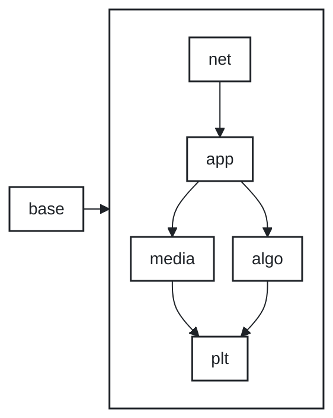
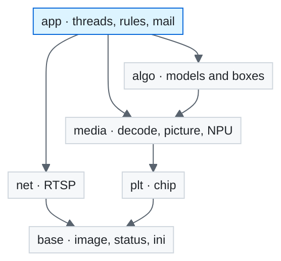
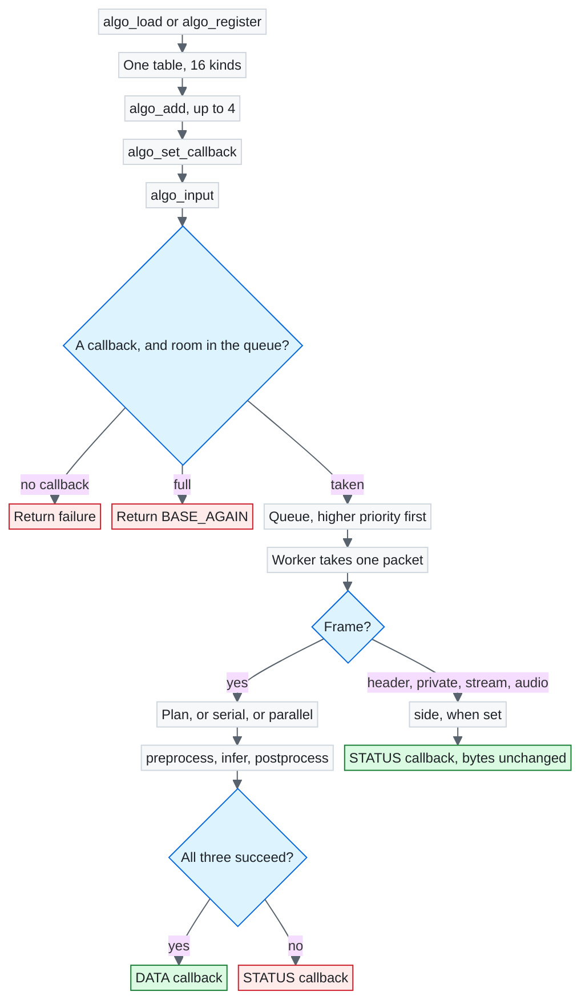
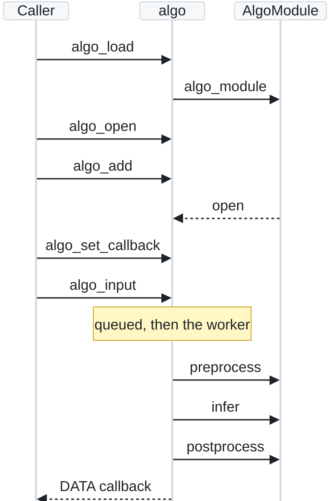
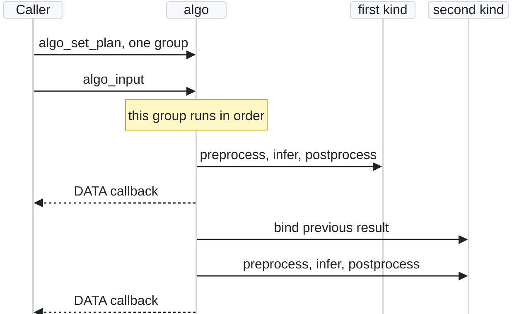
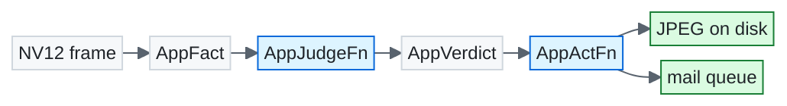
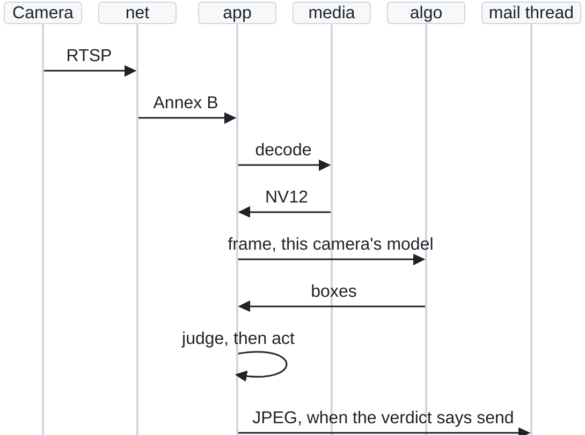

# Pet Monitor

English | [中文](README.zh.md)

Home cameras come in over RTSP. On an RK3588 the process pulls each stream, decodes it in hardware, and runs a cat detector on the NPU. When a rule fires, it writes a JPEG with boxes and sends that picture by email.

Each camera is one thread, with its own model and score. Mail goes out on another thread. `SIGINT` or `SIGTERM` stops the process.

## Features

- One thread per camera. After a stream drops, that thread opens it again.
- The default cat model is [Catto](https://github.com/VioletEqz/Catto), a YOLOv5s trained on cats. This process loads the RKNN export `models/Catto.rknn` (FP16, 640×640, one output of boxes and scores).
- Two rules, and either one is enough. Two or more cats in the whole frame, or one cat inside a region.
- After a picture is sent, that camera stays quiet for `cooldown_sec`.
- The rule and the follow-up are two function pointers. Another product replaces those functions and leaves the pipeline in place.
- `PM_PLATFORM=stub` builds the same interfaces on a machine with no chip, for tests.

## Quick start

The board needs MPP, librga, RKNN, FFmpeg (`libavformat`, `libavcodec`, `libavutil`), and OpenSSL. `rknn_api.h` ships in `src/plt/rk3588/include` and matches the 1.5.2 runtime. Point the MPP and librga include directories at the local SDK headers, then build the binary:

```sh
cmake -S . -B build -DPM_PLATFORM=rk3588 \
  -DPM_MPP_INCLUDE=/usr/include/rockchip \
  -DPM_RGA_INCLUDE=/usr/include/rga
cmake --build build --target pet-monitor
./build/pet-monitor conf/pet-monitor.ini
```

`make` does the same configure-and-build when `PM_MPP_INCLUDE` and `PM_RGA_INCLUDE` are set. The Makefile defaults them to `/usr/include/rockchip` and `/usr/include/rga`.

With no argument the program reads `conf/pet-monitor.ini`. Copy that file, put real camera URLs and the SMTP account in your own ini, and keep that file out of git. `conf/local.ini` is already ignored. The sample leaves `[email] enable` off and the account fields empty.

`[base] dir` is the path root. A relative model path or shot directory is joined onto it. The sample root is `/opt/pet-monitor`, so the cat model is `/opt/pet-monitor/models/Catto.rknn`. Training code and the `.pt` weights are in [VioletEqz/Catto](https://github.com/VioletEqz/Catto). Detect and track load `models/yolov5s-640-640.rknn` and keep the cat class.

On a machine with no chip:

```sh
cmake -S . -B build -DPM_PLATFORM=stub
cmake --build build
ctest --test-dir build --output-on-failure
```

`stub` fails in `plt_init` on purpose. It compiles the interfaces and runs the tests. It does not pull a live camera. The `pet-monitor` binary is built for `rk3588`.

## Configuration

`conf/pet-monitor.ini` is the full sample. The addresses there are placeholders.

| Section | What it sets |
| --- | --- |
| `[base]` | `dir`, the root for relative paths. |
| `[camera]` | Shared `timeout_ms` and `transport` (`tcp` or `udp`). |
| `[camera.<name>]` | One camera: `url` (`rtsp://`), `place`, `algo`, `score_min`, optional `roi`. |
| `[algo]` | Model paths, default score, `nms_iou`, queue depth, NPU device. |
| `[media]` | `jpeg_quality` for the saved picture, and encoder fields for a later recorder. |
| `[event]` | Stay time, snapshot time, pair time, cooldown, and `shot_dir`. |
| `[email]` | SMTP. `enable` must be true, and `host`, `from`, `to` must be set, before mail is sent. |

`place` is `eat`, `litter`, `living`, `客厅`, `balcony`, or `阳台`. `algo` is `detect`, `track`, `recognize`, or `cat`. The default algorithm is `cat`. `roi` is `x,y,w,h` in source-frame pixels. Up to eight cameras, in file order.

## Layers

`base` stands beside the stack. Every library in the box may use it. From the top of the box: `net`, then `app`, then `media` and `algo` side by side, then `plt`. An arrow here runs from the upper layer to the layer under it. `app` is the only place that joins a URL, a decoder, a model, a rule, and a mailer. A lower library returns a status, or invokes a function the caller registered.



In the source, `app` calls `net`. `algo` calls `media`, and `media` calls `plt`. Chip SDK headers live in `src/plt/rk3588`. `PM_PLATFORM` selects `stub` or `rk3588`. A new chip is a new directory under `src/plt`; the headers in `src/plt/include/plt` stay.

The arrows below are library links.



A picture crosses a library as `BaseImage`. The platform hands out NV12 or RGB888.

| Library | Directory | Role |
| --- | --- | --- |
| `base` | `src/base` | `BaseStatus`, `BaseImage`, and the ini reader. Every layer may use it. |
| `plt` | `src/plt` | Chip IP behind one C API: memory, decode, 2D, JPEG, encode, one NPU run. `stub` or `rk3588`. |
| `media` | `src/media` | Buffers, decode, scale and color, draw, JPEG, and `media_npu_run`. No detection postprocess. |
| `net` | `src/net` | One RTSP camera, one Annex-B frame. FFmpeg types stay inside this library. |
| `algo` | `src/algo` | One handle, a queue, up to four algorithms. Built-ins: detect, track, recognize, cat. A plugin exports `algo_module` and is loaded with `algo_load`. |
| `app` | `src/app` | Read the ini, run one thread per camera, judge, act, and send mail. `pet-monitor` calls `app_run`. |

`libapp` is static. The public headers are C. C++11 is used in two places: the RK3588 platform, because librga headers carry C++ default arguments, and the mailer, which links OpenSSL.

## Algorithms

One handle runs up to four algorithms. The worker does not branch on the kind number. It calls `preprocess`, `infer`, and `postprocess` on an `AlgoModule`, then the callback. Detect, track, recognize, and cat (`0` through `3`) register themselves the first time the library is used. Another kind is the same table, filled from outside. The queue, the priority, and the choice of serial or parallel stay in `algo.c`.

A new kind is a positive integer other than those four, a name, a `result_size` from 1 to 4096 bytes, and the five functions. `side` is optional. It runs for a header, private data, a stream, or audio. The table holds 16 modules. The same kind twice fails.

```c
static const AlgoModule g_mod =
{
    80,
    "pose",
    (int)sizeof(PoseResult),
    PoseOpen,
    PoseClose,
    PosePre,
    PoseInfer,
    PosePost,
    NULL
};

const AlgoModule *algo_module(void)
{
    return &g_mod;
}
```

Build that as a shared library. `algo_load` looks up `algo_module`. `algo_register` puts the same struct in the table without `dlopen`. `tests/algo_probe.c` is this shape, with kind `80`.

On a handle, mount the model, then the callback. A slot with no callback does not run. `algo_add` fails while a packet is queued or running, and it stops at four kinds. `algo_set_config` keeps a short byte string and hands it back on every callback.

```c
algo_load("libpose.so");
algo_open(&param, &ai);
algo_add(ai, 80, "models/pose.rknn");
algo_set_callback(ai, 80, OnPose, user);
algo_input(ai, &in);
```

`algo_input` returns when the packet is queued. A full queue returns `BASE_AGAIN`, and the packet was not taken. A handle with no callback returns failure, and the packet stays out. The frame, the side buffer, and `tag` stay valid until every callback for that input returns. The callback runs on the worker, or on a parallel thread. It does not call `algo_close`.

A frame walks the three functions. All three succeeding is a `DATA` callback, and `buf` is that module's result. Any failure is a `STATUS` callback. A packet that is not a frame skips the model, calls `side` when it is set, and comes back as `STATUS` with the original bytes.



Without a plan, a frame runs every mounted algorithm that has a callback. `ALGO_EXEC_SERIAL` follows mount order. `ALGO_EXEC_PARALLEL` runs them together. `algo_set_plan` names the groups. Groups run together. Inside a group the order is the plan, and from the second step a module may `bind` the previous result before `preprocess`. A failed step ends that group. A null plan restores `exec`.

Mounting a plugin and running one frame:



Serial steps share one group. The plan lists them in order. The second `bind` receives the first result, then that step runs. A failed step stops the rest of the group. Other groups on the same frame still run.



Cat detection is kind `3`. `algo_add(ai, ALGO_CAT_DET, "models/Catto.rknn")` uses the built-in module. It does not call `algo_load`.

## Rules and actions

The camera loop is fixed. For each decoded frame it fills an `AppFact`: monotonic time, how many cats are in the frame, how many box centers sit in the region, the camera, and the boxes. It then calls the judge. The judge writes an `AppVerdict`. The action reads that verdict.

`keep` asks for a boxed JPEG of this frame. `send` writes the JPEG that was kept and hands the same bytes to the mail queue. `drop` throws away a JPEG kept on an earlier frame. `pair` selects the `2cats` file name; otherwise the name contains `event`. The default action applies `drop`, then `keep`, then `send`. Each flag is its own request.

```c
static void MyJudge(const AppFact *fact, void *user, AppVerdict *out)
{
    (void)user;
    out->keep = fact->roi_cats > 0;
    out->send = fact->roi_cats > 0;
    out->drop = 0;
    out->pair = 0;
}

int main(int argc, char **argv)
{
    AppRunJudge judge;
    const char *path;

    memset(&judge, 0, sizeof(judge));
    judge.judge = MyJudge;
    app_run_set_judge(&judge);
    path = argc > 1 ? argv[1] : "conf/pet-monitor.ini";
    return app_run(path) == BASE_OK ? 0 : 1;
}
```

Call `app_run_set_judge` and `app_run_set_act` before `app_run`. A null pointer, or a null function inside the struct, puts the built-in back.

The built-in judge is `app_watch_judge`. Its state can be per camera: `open` returns that state, `reset` runs each time the stream is opened again, and `kept` runs after a JPEG encode succeeds. The built-in action is `app_act_run`: draw the boxes, encode, write the file, and post to the mail thread. `AppRunAct.user` is one pointer shared by every camera. `app_watch_test` feeds the judge counts and a clock. `app_act_test` feeds the action a verdict.

The same shape shows up under the application. `media` is the chip API the rest of the tree calls. `algo` is the model API: the four built-ins register themselves, and another network is a shared library with `algo_module`.



## Default rule

Detection runs on the whole frame, and every box is kept. The region is used by the single-cat rule. A box counts when its center falls inside `roi`. With no `roi`, that rule sees the whole frame.

The two timers do not clear each other.

- Two or more cats in the whole frame, continuously, for `pair_sec` (default 3). The current frame is kept and sent. The file name contains `2cats`. Dropping to one cat, or to none, clears this timer.
- One cat inside the region. The frame at `shot_sec` (default 10) is kept. It is sent when the stay reaches `present_sec` (default 20). The file name contains `event`. A frame with no cat in the region clears this timer and drops the kept JPEG.

After either send, that camera is quiet for `cooldown_sec` (default 600). Counting starts again on the frame where the quiet period ends.

The file name is `<camera>_event_<YYYYMMDD>_<HHMMSS>.jpg` or `<camera>_2cats_<YYYYMMDD>_<HHMMSS>.jpg`. The clock is UTC+8. The directory is `[event] shot_dir`.

## One frame



A failed read ends that attempt. The camera thread waits about two seconds and opens the URL again. `net_close` on the stop path interrupts a read that is still in progress.

## Tests

`PM_PLATFORM=stub`, then `ctest --test-dir build --output-on-failure`.

`app_watch_test` and `app_act_test` build on either platform. They cover the stay timer and the default action. On RK3588, `algo_cat_demo` runs one JPEG through the cat model:

```sh
./build/algo_cat_demo path/to/cat.jpg models/Catto.rknn
```

## Status and what comes next

This repository is a framework that finishes the cat-detection job. Recording and muxing belong to a later project.

- Each camera runs on one thread, and pulling, decoding, and inference happen one after another. Another task added to that thread stalls the whole camera. A larger project gives each step its own thread, and that split is part of managing performance.
- Threads have no names, no heartbeat, and no watchdog, and a crash does not write a stack trace.
- There is no separate logging thread and no statistics counter.
- Event recording is not here. Nothing about recording is implemented.

## A note

This project stops here for now. I'll add more when something else comes to mind. It is a framework: the app layer puts the work together, and an algorithm goes in as a plugin. I think that leaves enough room to extend it. If you have an idea, get in touch.
