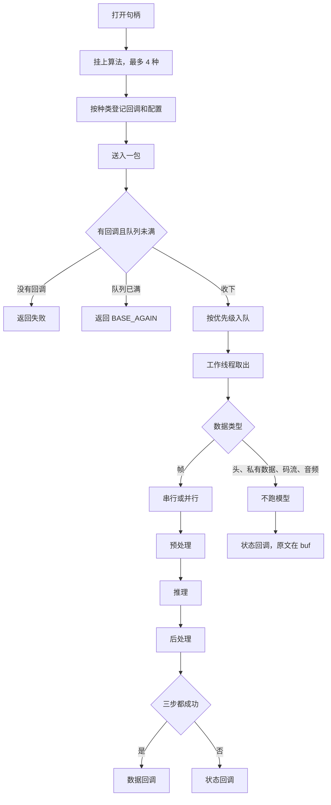

# pet-monitor

摄像头对着食盆和猫砂盆，记录猫的进食和上厕所。

家用网络摄像头通过 RTSP 接入，检测跑在 RK3588 上。一次进食或上厕所结束后留下记录。

用法和配置以后再补。

## 分层

上层只包含 `base` 和 `media`。`media` 的实现才能包含 `src/plt/include/plt`。芯片头文件只出现在 `src/plt/rk3588`，不放进仓库。

换芯片时新增 `src/plt/<芯片>`，`PM_PLATFORM` 选那个目录，公开头不动。这一版只有 `stub` 和 `rk3588`。

图像过接口时是 `BaseImage`。有没有图像看 `handle`。`fd` 和 `ptr` 可以没有。像素格式只有 NV12 和 RGB888，芯片内部的其它格式在平台层转完再交出来。解码只出整帧。整图缩放到模型输入用 `media_pic_scale`。检测先等比例缩进模型尺寸，再在短边两侧补灰，用 `media_pic_preprocess`。芯片做不到的能力返回 `BASE_UNSUPPORTED`。

## 平台层

`PM_PLATFORM` 选 `stub` 或 `rk3588`。`stub` 的 `plt_init` 会失败，用来在没有芯片的机器上编译和跑接口测试。`rk3588` 需要本机的 MPP、librga、RKNN 头文件，用 `PM_MPP_INCLUDE`、`PM_RGA_INCLUDE`、`PM_RKNN_INCLUDE` 指过去。

公开接口是 C。C++11 用于两处：RK3588 平台层，因为 librga 的头文件带 C++ 默认参数；应用层发信。

`plt_rga_*` 是二维引擎，名字是历史留下的。上层用 `media_pic`，不直接调用它。

## 网络

拉流在 `net`。头文件是 `net_cfg.h` 和 `net_pull.h`。这一层只包含 `base`，FFmpeg 的类型不出公开头。

`net_cfg_from_ini` 读 `[camera]` 的超时和传输方式，以及每一路 `[camera.名字]` 的 `url`。不读 `place`。`url` 要以 `rtsp://` 开头。传输方式缺省是 tcp。

`net_open` 连接一路。`net_info` 给出编码、宽高和参数集，参数集保持到 `net_close`。`net_read` 在调用方线程上阻塞，直到交出一帧 Annex B。这一帧保持到下一次读或关闭。断开返回失败，不在这里重连。`net_close` 可以从另一线程打断正在读的那一次。

## 媒体层

媒体层放基础图像接口，目录是 `src/media`。库名是 `media`。用其它媒体接口之前先 `media_init`，用完 `media_deinit`。

- 缓冲：`media_mem_alloc`、`media_mem_free`、`media_mem_flush`。解码帧用 `media_dec_release` 归还，不要用 `media_mem_free`。
- 推理：`media_npu_open` 加载单输入模型，`media_npu_run` 跑一次。张量带类型、量化方式、零点和 scale。这里不做检测后处理。
- 解码：`media_dec_open`、`media_dec_send`、`media_dec_receive`、`media_dec_release`。类型是 `MediaDec`。
- 缩放、拷贝、转色：`media_pic_scale`。尺寸相同是拷贝，格式不同时顺带转色。
- 推理前预处理：`media_pic_preprocess`。等比例缩放后把短边两侧补成 RGB 114，并写出灰边位置，后面把框映回原图时用这一份。
- 画线、画框、填色：`media_pic_line`、`media_pic_box`、`media_pic_fill`。里面调用平台层对应的接口。
- 旋转、翻转、平移：`media_pic_rotate`、`media_pic_flip`、`media_pic_translate`。旋转为顺时针 90/180/270。
- JPEG：`media_jpeg_encode` 编码，`media_jpeg_decode` 解码。编码返回时码流已经出来，用 `media_jpeg_free` 释放。解码得到全范围 NV12，用 `media_mem_free` 释放。
- 视频编码：类型是 `MediaEnc`，打开用 `media_enc_open`。参数不合法返回失败。平台层没有视频编码器时，参数合法也返回不支持。送帧、取流、参数集、关键帧、改码率和感兴趣区域都交给已打开的编码器。参数集用 `media_enc_extradata` 取，关闭前一直有效。感兴趣区域由调用方给出，这里不按画面区域改写。OSD 用 `media_enc_set_osd` 送最多 8 块下标图，颜色用 `media_enc_set_osd_palette`。编码旋转、镜像用 `media_enc_set_rotation`、`media_enc_set_mirror`。旋转为逆时针 0/90/180/270，镜像 0 无、1 水平、2 垂直。

公共类型在 `base`，例如 `BaseImage`、`BaseStatus`、`BASE_OK`。平台层库名是 `plt`。

## 智能

智能在 `algo`，头文件是 `algo.h`，库是共享库 `libalgo`。它调用 `media` 的缓冲、预处理和 `media_npu_run`，不包含芯片头文件。一个句柄一条队列，最多挂 4 种算法。打开时记下分辨率、连接方式、设备号、模块号和队列深度。设备号大于 0 时，内置算法用它选择 NPU 核。队列深度为 0 时用 2，最大 8。队列满返回 `BASE_AGAIN`，这一包没有收下，调用方稍后重送。

检测、追踪、识别、猫检测四项一起编进 `libalgo`，启动时自己登记。别的算法做成外部插件，导出 `algo_module`，用 `algo_load` 装入。每种算法自己提供打开、预处理、推理、后处理和旁路处理。挂上一种算法后再用 `algo_set_callback` 登记它的回调，配置原文用 `algo_set_config` 保存，回调时一并带上。没有回调的算法不跑。

送入用 `algo_input`。帧走预处理、推理、后处理。头、私有数据、码流和音频不跑模型。帧和这些旁路数据要保持到这次送入的回调都返回。回调在工作线程里，里面不能关闭句柄。同一帧上多种算法可以串行，也可以并行。串行按挂上的顺序。并行时每种算法各跑各的模型。优先级越大越先取出。

四项内置算法的结果各用各的结构。没有目标时检测、追踪和猫检测仍回调，`count` 为 0。检测和追踪加载 `models/yolov5s-640-640.rknn`。猫检测直接 `algo_add(ai, ALGO_CAT_DET, "models/Catto.rknn")`，不用先 `algo_load`。两份模型输入都是 640×640。`Catto.rknn` 是 FP16，单个输出已经是框和分数。

| 算法 | 预处理 | 推理之后 | 回调里的 buf |
|---|---|---|---|
| 检测 | 等比例缩放，短边两侧补灰 | 只留猫，框映回原图，最多 32 个 | `AlgoDetectResult` |
| 追踪 | 与检测相同 | 用上一帧的框延续编号 | `AlgoTrackResult` |
| 识别 | 整图缩放到模型输入 | 取得分最高的一类 | `AlgoRecog` |
| 猫检测 | 等比例缩放，短边两侧补灰 | 框映回原图，类别是猫 | `AlgoDetectResult` |

## 应用层

应用层目前只放发信。目录是 `src/app`，库名是 `app`。头文件在 `src/app/include`，接口是 `app_email_send`。实现用 C++11。

发信依赖 OpenSSL（`libssl` 和 `libcrypto`）。嵌入式设备上的库路径和链接关系需要自行配置。本工程使用 `find_package(OpenSSL)` 去链接系统里的 OpenSSL。
