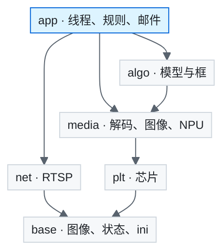
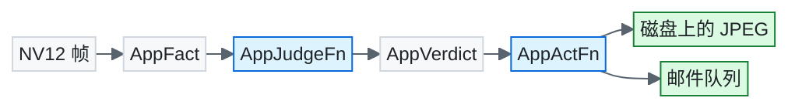
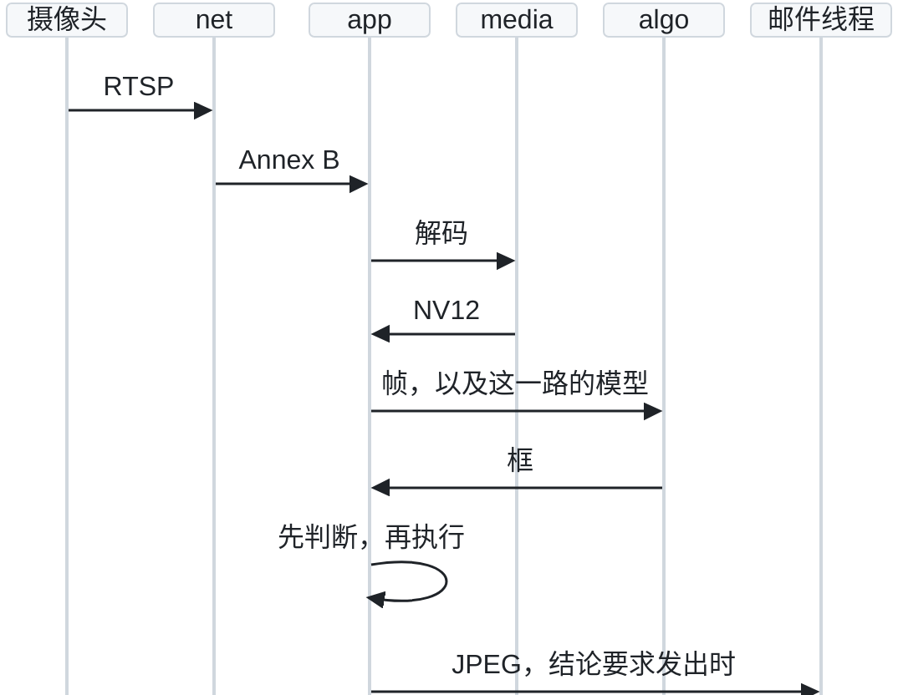

# Pet Monitor

[English](README.md) | 中文

家用摄像头通过 RTSP 接入。程序在 RK3588 上拉流、硬解码，并用 NPU 做猫检测。规则成立时，把画了框的 JPEG 写到本地，再把同一张图发出去。

每路相机一条线程，各用各的模型和置信度。邮件在另一条线程里发出。`SIGINT` 或 `SIGTERM` 结束进程。

## 功能

- 每路相机一条线程。流断了，由这一条线程再次打开。
- 默认猫模型是 [Catto](https://github.com/VioletEqz/Catto)，一份在猫数据上训练的 YOLOv5s。本程序加载它的 RKNN 导出 `models/Catto.rknn`（FP16，640×640，单个输出已经是框和分数）。
- 两条规则，成立一条即可。全画面有两只及以上的猫，或者检测区域内有一只猫。
- 一张图发出去之后，这一路在 `cooldown_sec` 内不再发。
- 判断和后续执行是两个函数指针。换产品时换这两个函数，拉流、解码、推理的循环留在原地。
- `PM_PLATFORM=stub` 在没有芯片的机器上编译同一套接口，用来跑测试。

## 快速开始

板子上需要 MPP、librga、RKNN、FFmpeg（`libavformat`、`libavcodec`、`libavutil`）和 OpenSSL。把头文件目录指到本机 SDK，再编可执行文件：

```sh
cmake -S . -B build -DPM_PLATFORM=rk3588 \
  -DPM_MPP_INCLUDE=/usr/include/rockchip \
  -DPM_RGA_INCLUDE=/usr/include/rga \
  -DPM_RKNN_INCLUDE=<rknn 头文件目录>
cmake --build build --target pet-monitor
./build/pet-monitor conf/pet-monitor.ini
```

三个头文件目录都已设置时，`make` 做同样的配置和编译。Makefile 里前两个的缺省值是 `/usr/include/rockchip` 和 `/usr/include/rga`。

不带参数时读 `conf/pet-monitor.ini`。复制这份样例，把真实的相机地址和发信账号写进自己的 ini，不要提交。`conf/local.ini` 已经在忽略列表里。样例里 `[email] enable` 关闭，账号是空的。

`[base] dir` 是路径根。模型路径和存图目录写成相对路径时，接到这个根后面。样例根目录是 `/opt/pet-monitor`，猫模型就是 `/opt/pet-monitor/models/Catto.rknn`。训练代码和 `.pt` 权重在 [VioletEqz/Catto](https://github.com/VioletEqz/Catto)。检测和追踪加载 `models/yolov5s-640-640.rknn`，只留下猫这一类。

没有芯片时：

```sh
cmake -S . -B build -DPM_PLATFORM=stub
cmake --build build
ctest --test-dir build --output-on-failure
```

`stub` 的 `plt_init` 会失败，这是故意的。它用来编译接口和跑测试，不能拉实机流。`pet-monitor` 只在 `rk3588` 下生成。

## 配置

完整样例是 `conf/pet-monitor.ini`。里面的地址是占位。

| 段 | 作用 |
| --- | --- |
| `[base]` | `dir`，相对路径的根。 |
| `[camera]` | 各路共用的 `timeout_ms` 和 `transport`（`tcp` 或 `udp`）。 |
| `[camera.<名字>]` | 一路相机：`url`（`rtsp://`）、`place`、`algo`、`score_min`，可选 `roi`。 |
| `[algo]` | 模型路径、缺省分数、NMS、队列深度、NPU 设备号。 |
| `[media]` | 存图用的 `jpeg_quality`，以及以后录像会用到的编码项。 |
| `[event]` | 停留、留图、两只猫、冷却，以及 `shot_dir`。 |
| `[email]` | SMTP。`enable` 为真，并且 `host`、`from`、`to` 都有值，才会发信。 |

`place` 取 `eat`、`litter`、`living`、`客厅`、`balcony`、`阳台`。`algo` 取 `detect`、`track`、`recognize`、`cat`，缺省是 `cat`。`roi` 写成 `x,y,w,h`，单位是原图像素。最多八路，按文件里的顺序。

## 分层

六个库。哪一路地址进哪个解码器、挂哪个模型、用哪条规则、信发给谁，只在应用层写。下层返回状态码，或调用上层登记过的函数。



箭头是链接关系。`net` 交出一帧 Annex B，相机线程再把这一包送给 `media`。芯片 SDK 的头文件在 `src/plt/rk3588`。要用芯片，走 `media`。`PM_PLATFORM` 选择 `stub` 或 `rk3588`。换芯片时在 `src/plt` 下加一个目录，`src/plt/include/plt` 里的头文件保持不动。

图像过库时是 `BaseImage`。平台交出来的像素是 NV12 或 RGB888。

| 库 | 目录 | 作用 |
| --- | --- | --- |
| `base` | `src/base` | `BaseStatus`、`BaseImage`、ini 读取。每一层都可以用。 |
| `plt` | `src/plt` | 芯片 IP 的一套 C 接口：内存、解码、二维、JPEG、编码、一次 NPU 推理。`stub` 或 `rk3588`。 |
| `media` | `src/media` | 缓冲、解码、缩放和转色、画框、JPEG、`media_npu_run`。这里不做检测后处理。 |
| `net` | `src/net` | 一路 RTSP，交出一帧 Annex B。FFmpeg 的类型留在这个库里面。 |
| `algo` | `src/algo` | 一个句柄、一条队列，最多四种算法。内置检测、追踪、识别、猫检测。外部插件导出 `algo_module`，用 `algo_load` 装入。 |
| `app` | `src/app` | 读 ini，每路一条线程，判断，执行，发信。`pet-monitor` 调用 `app_run`。 |

`libapp` 是静态库。公开头文件是 C。C++11 用在两处：RK3588 平台层，因为 librga 的头文件带 C++ 默认参数；发信，它链接 OpenSSL。

## 判断和执行

相机循环是固定的。每一帧解码之后填一份 `AppFact`：单调时钟、全画面的猫数、框中心落在区域内的猫数、这一路相机、检测框。然后调用判断函数。判断函数写出 `AppVerdict`。执行函数按这份结论去做。

`keep` 要求把这一帧画框并编成 JPEG 留下来。`send` 把留下的 JPEG 写盘，并把同一份字节交给邮件队列。`drop` 丢掉更早留下的那张 JPEG。`pair` 让文件名带 `2cats`，否则文件名带 `event`。默认执行先做 `drop`，再做 `keep`，再做 `send`。三个标志各自是一次请求。

```c
static void MyJudge(const AppFact *fact, void *user, AppVerdict *out)
{
    (void)user;
    out->keep = fact->roi_cats > 0;
    out->send = fact->roi_cats > 0;
    out->drop = 0;
    out->pair = 0;
}

int main(int argc, char **argv)
{
    AppRunJudge judge;
    const char *path;

    memset(&judge, 0, sizeof(judge));
    judge.judge = MyJudge;
    app_run_set_judge(&judge);
    path = argc > 1 ? argv[1] : "conf/pet-monitor.ini";
    return app_run(path) == BASE_OK ? 0 : 1;
}
```

在 `app_run` 之前调用 `app_run_set_judge` 和 `app_run_set_act`。传入空指针，或者结构里的函数是空的，就恢复内置实现。

内置判断是 `app_watch_judge`。状态可以按路分开：`open` 返回这一路的状态，`reset` 在每次重新打开流时调用，`kept` 在 JPEG 真正编出来之后调用。内置执行是 `app_act_run`：画框、编码、写文件、交给邮件线程。`AppRunAct.user` 是各路共用的一个指针。`app_watch_test` 用猫的只数和时钟喂判断。`app_act_test` 用一份结论喂执行。

应用层下面是同一件事。`media` 是树上其余代码调用的芯片接口。`algo` 是模型接口：四项内置算法自己登记，另一份网络做成导出 `algo_module` 的共享库。



## 默认规则

检测在整幅画面上做，检出的框都保留。检测区域只参与一只猫那条规则。框的中心落在 `roi` 里才算。没写 `roi` 时，这一条看整幅画面。

两条计时互不相消。

- 全画面同时有两只及以上的猫，并且连续满 `pair_sec`（缺省 3 秒）。留下当前这一帧并发出，文件名带 `2cats`。中间掉成一只或没有，只清这条计时。
- 检测区域内有一只猫。出现满 `shot_sec`（缺省 10 秒）留下那一帧，连续停留满 `present_sec`（缺省 20 秒）再发出，文件名带 `event`。区域内这一拍没有猫，这条计时清掉，已留的图也丢掉。

任意一种发出去之后，这一路进入冷却，`cooldown_sec`（缺省 600 秒）内不再发。冷却结束从那一拍重新计。`absent_sec` 仍从配置读入，再发间隔以 `cooldown_sec` 为准。

文件名是 `<相机名>_event_<年月日>_<时分秒>.jpg` 或 `<相机名>_2cats_<年月日>_<时分秒>.jpg`。时间用东八区。目录是 `[event] shot_dir`。

## 一帧的路径



一次读取失败就结束这一轮。相机线程大约等两秒，再打开同一个地址。重连写在相机线程里。停止时，`net_close` 打断正在进行的那一次读。

## 测试

`PM_PLATFORM=stub`，然后 `ctest --test-dir build --output-on-failure`。

`app_watch_test` 和 `app_act_test` 在两种平台上都会编出来，分别覆盖停留计时和默认执行。在 RK3588 上，`algo_cat_demo` 用一张 JPEG 走一遍猫模型：

```sh
./build/algo_cat_demo path/to/cat.jpg models/Catto.rknn
```
